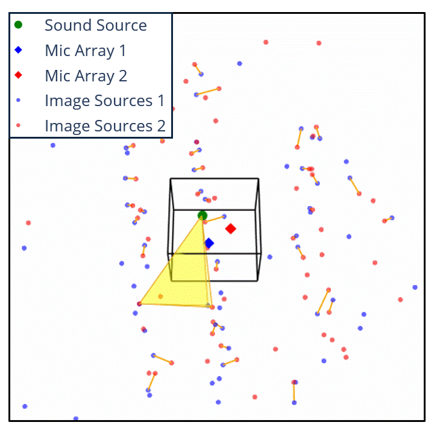
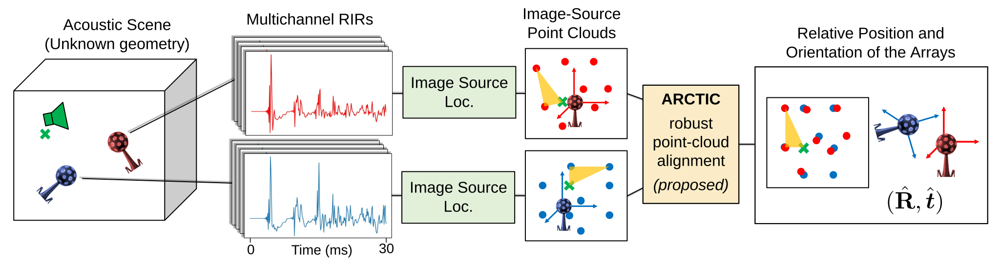

# ARCTIC - Anchor-based Registration using Congruent Triangle Consensus

This repository provides the source code of the ARCTIC algorithm, presented in the paper: *Self-Localization of Distributed Microphone Arrays Using One Source and Acoustic Reflections*, submitted at ICASSP 2027.





## Overview

We present a method to estimate the relative position and orientation of two non-coplanar microphone arrays using a room impulse response (RIR) from a single source. The approach exploits early acoustic reflections, retrieved by each array in the form of a 3D image-source point cloud. The task is then reduced to aligning the two unlabeled point clouds, which is made difficult by their inherent symmetries and by spurious, missing and noisy estimates.

To this aim we introduce **ARCTIC**, a point-cloud registration algorithm that performs a ranked search over congruent triangles anchored on the true source. ARCTIC was designed to be robust to spurious, noisy and missing points, and is initialization-free.

ARCTIC is one piece of a whole pipeline, depicted below:




The image-source localization block is based on these two previous works:

> J.-D. Pascal Prieto, A. Deleforge, C. Foy, and M. Tonelli, “Bridging the measurement–simulation gap in room acoustics with real2sim diffusion,” in IEEE Int. Conf. on Acoust., Speech and Signal Process. (ICASSP). IEEE, 2026, pp. 14922–14926.

> T. Sprunck, A. Deleforge, Y. Privat, and C. Foy, “Gridless 3d recovery of image sources from room impulse responses,” IEEE Signal Process. Letters, vol. 29, pp. 2427–2431, 2022.


## Main Features

This repository provides:

- ARCTIC's source code in [arctic.py](arctic.py);
- Useful functions to visualize and evaluate ARCTIC's performance in [tools.py](tools.py);
- A Python notebook which presents how to use ARCTIC ([arctic_examples.ipynb](arctic_examples.ipynb)). We provide examples from simulated data and real data extracted from the ARPEGE dataset, as presented in our paper.


> J.-D. Pascal Prieto, A. Deleforge, C. Foy, and P. Srivastava, “Arpege: Dataset and methods to estimate acoustic and geometric parameters of rooms from sound,” in Int. Workshop on Acoust. Signal Enhancement (IWAENC). IEEE, 2026.


## Installation

Create a virtual environment with Python 3.14.7, and run the following command to install the dependencies:

```bash
pip install -r requirements.txt 
```

The package versions in `requirements.txt` are expected to be compatible with Python 3.14.7.

Usage examples are provided in the [notebook](arctic_examples.ipynb).


## Citation

Please cite our work using the BibTeX entry from the ArXiv paper. The paper will be available soon.


## License

```
# Copyright (C) 2026  Thomas GUFFROY

# This program is free software: you can redistribute it and/or modify
# it under the terms of the GNU General Public License as published by
# the Free Software Foundation, either version 3 of the License, or
# (at your option) any later version.

# This program is distributed in the hope that it will be useful,
# but WITHOUT ANY WARRANTY; without even the implied warranty of
# MERCHANTABILITY or FITNESS FOR A PARTICULAR PURPOSE.  See the
# GNU General Public License for more details.

# You should have received a copy of the GNU General Public License
# along with this program.  If not, see <https://www.gnu.org/licenses/>.
```